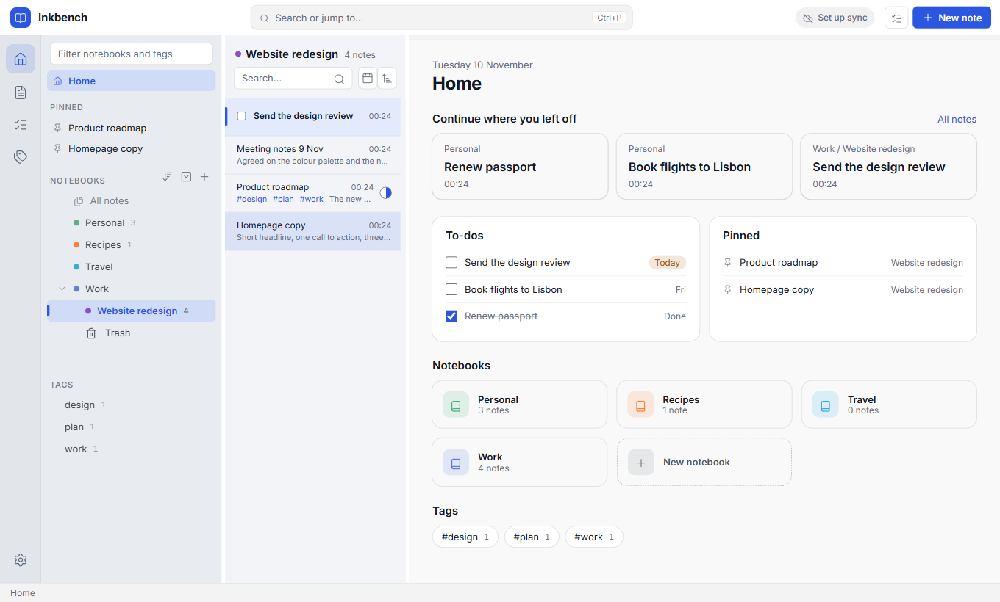
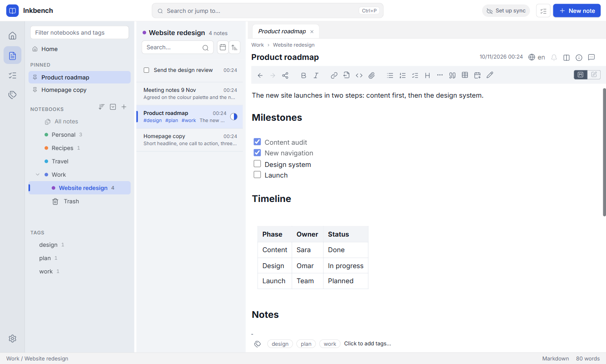
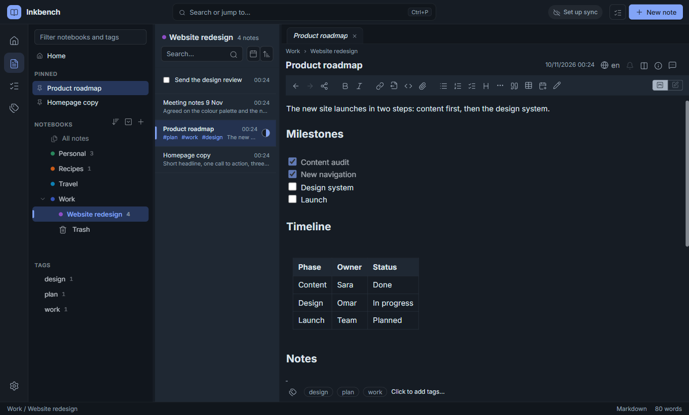
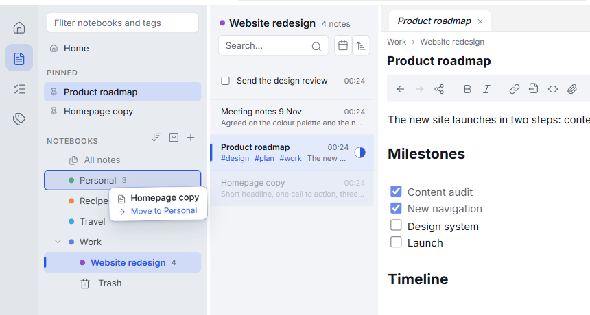
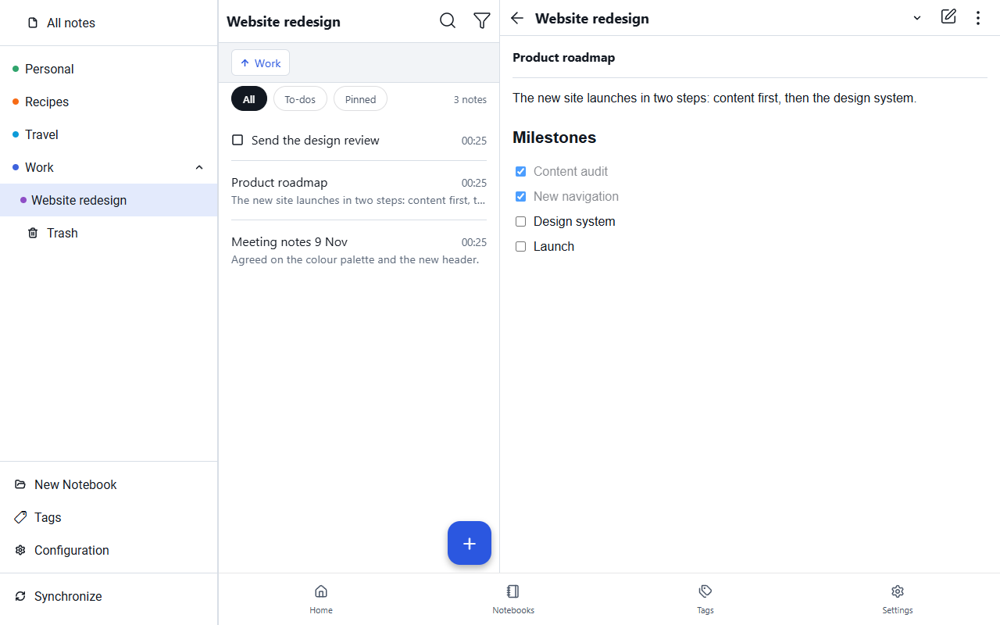
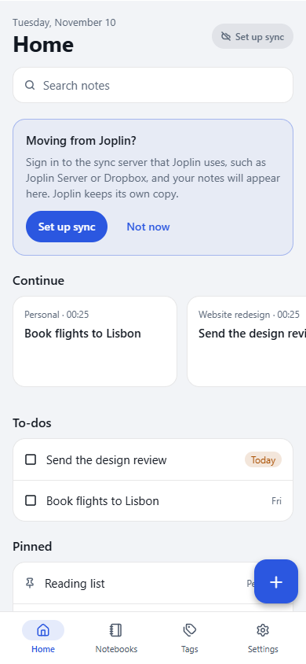

	

# Inkbench

Inkbench is a redesigned edition of [Joplin](https://joplinapp.org), the open-source note-taking app. It keeps what makes Joplin dependable: Markdown notes you own, end-to-end encryption, and sync with Joplin Server, Joplin Cloud, Dropbox, OneDrive, WebDAV or a folder. On top of that it gives you a calmer, faster workspace, built around a Home page.

Inkbench and Joplin use the same notes and the same sync, so they can share a sync server. Inkbench installs beside Joplin rather than replacing it, and can copy your Joplin notes on its first start.

> Inkbench is a community fork of Joplin. It isn't affiliated with or endorsed by the Joplin project.

## Download

| Platform | Download | Notes |
| --- | --- | --- |
| Windows (64-bit) | [Latest installer](https://github.com/ameralqarallih-lgtm/joplin/releases/tag/desktop-latest) | The installer isn't signed yet, so Windows SmartScreen asks you to confirm: choose "More info", then "Run anyway". |
| Android | [Latest APK](https://github.com/ameralqarallih-lgtm/joplin/releases/tag/android-latest) | Open the link on your phone. Android may ask you to allow installs from your browser. |

Versioned releases, with what changed in each, are on the [Releases page](https://github.com/ameralqarallih-lgtm/joplin/releases). The two links above always point to the newest build. macOS and Linux builds are [planned](https://github.com/ameralqarallih-lgtm/joplin/issues/60).

## What's different from Joplin

**A workspace built around Home**

- Home shows where you left off, your to-dos with their due dates, pinned notes, notebooks and tags.
- Notes open in tabs, which come back after a restart. A note you only glance at opens in a preview tab that the next one replaces.
- The top bar has search (Ctrl+P), sync status and New note. An outline of the note's headings, with its backlinks, sits beside the editor. The status bar shows sync activity and the word count.

**Organise your notes**

- Give notebooks a colour, from presets or any colour you choose.
- Drag notebooks above, below or into each other, and notes into any order. While you drag, a card shows exactly where the item will land.
- Pin the notes you use most.

**A calmer design**

- Workbench light and dark themes, with consistent line icons, the Inter font and compact rows that show more of each note.

**On your phone and tablet**

- A Home screen, a bottom bar, and All / To-dos / Pinned filters on every note list.
- Tags as chips, sub-notebooks at a tap, and pull down to sync.
- On tablets and wide windows, the note list sits beside the open note.

**Fixes for notes that didn't show as written**

- Tables, numbered lists, maths, diagrams, front matter and checklists now render and convert as written. Two of these bugs are also [reported to Joplin](https://github.com/ameralqarallih-lgtm/joplin/issues?q=label%3Aupstream).

<table>
	<tr>
		<td></td>
		<td></td>
	</tr>
	<tr>
		<td></td>
		<td></td>
	</tr>
</table>

## Moving from Joplin

- **Windows:** on its first start, Inkbench offers to copy your Joplin notes, notebooks, attachments and settings. Joplin and its notes are left exactly as they were. If you sync, enter your sync password once in Settings → Synchronisation, because Joplin keeps it in its own keychain.
- **Android:** apps can't read each other's data on Android, so sign in to the sync server that Joplin uses (Joplin Server, Dropbox and so on), and your notes appear. Home shows a shortcut to set this up.

## Versions and roadmap

The current version is Inkbench 0.4.0, based on Joplin 3.7.22 (desktop) and 3.7.11 (Android). See the [changelog](CHANGELOG.md) for what each version changed, and the [Inkbench 0.5.0 milestone](https://github.com/ameralqarallih-lgtm/joplin/milestone/5) for what's planned next. Found a problem? [Open an issue](https://github.com/ameralqarallih-lgtm/joplin/issues/new).

## Building from source

Inkbench builds like Joplin: see Joplin's [build instructions](../readme/dev/BUILD.md). [FORK.md](../FORK.md) explains how this fork works: its branches, builds, upstream tracking, and the design layer that keeps changes to Joplin's files small.

## Licence and credits

Inkbench is licensed, like Joplin, under the [AGPL-3.0-or-later](../LICENSE). It is built on Joplin by Laurent Cozic and its contributors. Its icons are [Lucide](https://lucide.dev) (ISC licence) and its interface font is [Inter](https://rsms.me/inter/) (SIL Open Font Licence).
